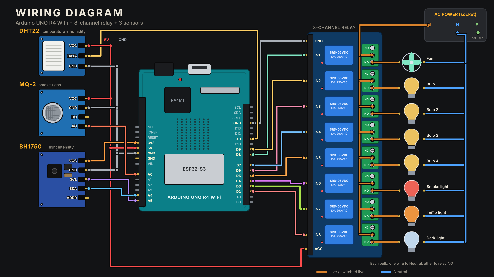

# home-automation

Smart home with an **Arduino UNO R4 WiFi**: home automation and home safety in one project.

- **3 sensors:** MQ-2 (smoke / gas), DHT22 (temperature + humidity), BH1750 (light)
- **8 relays:** a fan, 4 bulbs and 3 sensor lights (smoke light, temperature light, dark light), each sensor light in Auto or Manual
- **Web dashboard** for phone and laptop, hosted free on Cloudflare Pages, works from anywhere through Adafruit IO (MQTT)
- **WhatsApp agent:** type a message or send a voice note ("turn on the fan"), and get alerts for smoke, high temperature, Arduino offline or a sensor problem
- OpenAI understands your sentences (any language mix) and Whisper turns voice notes into text

## Build it with your AI assistant

Open **[SKILL.md](SKILL.md)** and give the whole file to any AI assistant (Claude, ChatGPT, ...).
Ask it: *"Guide me step by step to build this."* It walks you through parts, wiring, Arduino upload,
the cloud, the dashboard and the WhatsApp agent, one step at a time.

## What is in this repository

| Path | What it is |
|---|---|
| `SKILL.md` | the full step-by-step guide (also contains all the code) |
| `wiring_diagram.png` | the complete wiring diagram |
| `arduino/smartnest_v2/` | main firmware (`smartnest_v2.ino`) + `arduino_secrets.h` with placeholders |
| `arduino/happy_birthday_lights/` | optional fun test: plays Happy Birthday on the lights |
| `dashboard/` | the web page (phone + laptop) |
| `whatsapp_agent/` | the Python WhatsApp agent (`home_agent.py`, `requirements.txt`, `.env.example`) |

## How it works

    Sensors --> Arduino UNO R4 WiFi --> 8 relays --> fan, bulbs, sensor lights
                       |
                 Adafruit IO (cloud, MQTT)
                 /                     \
    Dashboard (Cloudflare Pages)    WhatsApp agent (Python on your computer)
                                       |            \
                                  you on WhatsApp   OpenAI (Whisper: voice -> text, GPT: text -> command)

## Quick start

1. Wire everything as in `wiring_diagram.png` (read the safety note first).
2. Arduino IDE: install the "Arduino UNO R4 Boards" package and the libraries `BH1750`, `DHT sensor library`, `ArduinoMqttClient`.
3. Open `arduino/smartnest_v2/smartnest_v2.ino`, fill your own values in the `arduino_secrets.h` tab, upload.
4. Make a free Adafruit IO account with two feeds: `home-status` and `home-cmd`.
5. Deploy the `dashboard/` folder: `npx wrangler pages deploy . --project-name home-control`.
6. WhatsApp agent: WhatsApp > Settings > Agents > Add agent, copy its API key. Then in `whatsapp_agent/`:
   copy `.env.example` to `.env`, fill it, and run
   `python3 -m venv venv && ./venv/bin/pip install -r requirements.txt && ./venv/bin/python home_agent.py`.

Every detail (and every known problem with its fix) is in [SKILL.md](SKILL.md).

## Safety

The relay side switches **mains electricity (110-240 V AC). It can kill.** Keep all high-voltage wiring
enclosed and insulated, unplug before touching anything, never touch live wires, and test with low-voltage
lamps first. If you are not sure, ask a qualified electrician.

## Keep your secrets private

Never upload your filled `arduino_secrets.h`, your `.env`, or any key (WiFi password, Adafruit IO key,
WhatsApp agent key, OpenAI key). `.gitignore` already keeps `.env` out of git. If a key leaks, regenerate it.

---
Built with the help of Claude.
